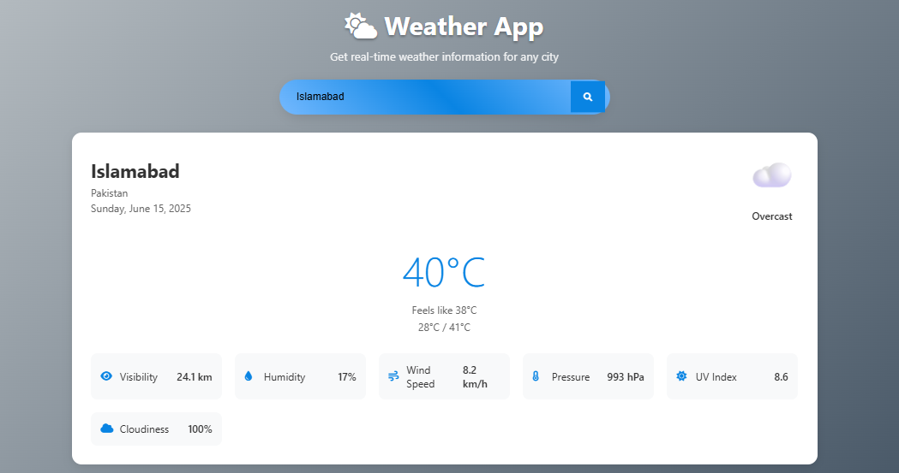
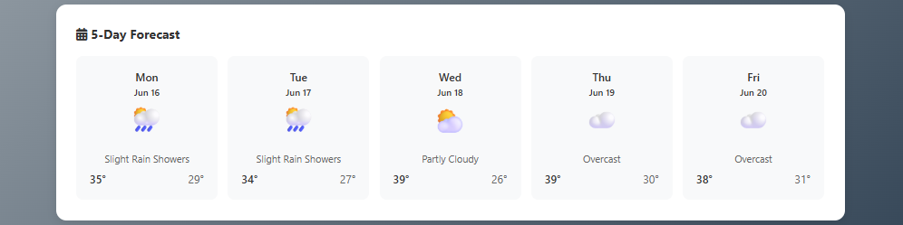

# Weather Forecasting

A responsive browser weather app using Open-Meteo city search and forecasts, with no API key or backend.

 




The screenshots above are retained repository assets and may differ from the updated controls.

## Features

- Search a city or choose one of the built-in city shortcuts.
- View current modeled conditions and the next five days of forecasts.
- Inspect temperature, apparent temperature, visibility, humidity, wind, pressure, daily maximum UV, and cloud cover.
- Request browser location explicitly; permission denial or unavailable geolocation falls back to London with a notice.
- Open keyboard-accessible weather detail dialogs and refresh the last searched city or coordinates.
- Handle empty searches, missing cities, network failures, timeouts, and incomplete API responses.

## Getting started

```sh
git clone https://github.com/shazeel-ahmed31/Weather-Forecasting.git
cd Weather-Forecasting
python -m http.server 8000
```

Open http://localhost:8000. The app starts with London; search another city or choose **Use my location**. Browser geolocation needs a secure context such as localhost or HTTPS. Coordinates are sent to Open-Meteo only after that action and browser permission. No build or npm dependency installation is required.

## Implementation

`weather-service.js` validates city and coordinate inputs, performs geocoding and forecast requests, checks HTTP/API failures and response structure, and formats values. `script.js` manages the interface and cancels superseded requests. Each weather lookup has a 15-second timeout. Suggestions are a fixed city list, while submitted searches use the geocoding API's first result.

Requests explicitly use Celsius, km/h, and the searched location's time zone. Visibility uses the hourly sample matching the API's current hour, not the first midnight sample. Missing values display `N/A`; zero remains a valid value. Calendar forecast dates retain their day across browser time zones. UV is the current day's maximum, not an instantaneous measurement.

No reverse-geocoding service is used; coordinate searches display **Your location**. API-derived city names and errors are rendered as text. Modal content uses text nodes and native dialog focus behavior. Motion preferences disable animations and new particles.

## Project structure

| File | Purpose |
| --- | --- |
| `index.html` | Search controls, current conditions, forecast, attribution |
| `styles.css` | Responsive layouts and weather effects |
| `weather-service.js` | API access, validation, formatting |
| `script.js` | Requests, interactions, dialogs, display |
| `tests/weather.test.js` | Mocked API and request-order regression tests |
| `.github/workflows/check.yml` | JavaScript syntax and automated tests |

## Checks

With Node.js 22 or later:

```sh
npm run check
npm test
```

For Windows environments that block spawned test processes:

```sh
node --test --experimental-test-isolation=none tests/weather.test.js
```

Tests cover encoded searches, units, missing cities, invalid coordinates, HTTP/network/API errors, malformed responses, zero/missing values, hourly alignment, calendar dates, request cancellation, stale results, and UI error propagation. Test responses are synthetic fixtures, not displayed as live weather.

## Attribution and limitations

Forecasts come from [Open-Meteo](https://open-meteo.com/) under [CC BY 4.0](https://creativecommons.org/licenses/by/4.0/). City search data is provided through Open-Meteo using GeoNames. See the [forecast documentation](https://open-meteo.com/en/docs) and [geocoding documentation](https://open-meteo.com/en/docs/geocoding-api) for source details and service terms. Font Awesome icons load from cdnjs.

Current conditions are modeled data, not direct local observations. City names can be ambiguous because this implementation takes the first geocoding result. Network access and third-party availability are required. This is a portfolio demonstration; no live deployment has been verified. Free API usage is subject to the provider's terms and limits.

Future improvements: selectable geocoding results, automated browser interaction tests, and caching with clearly labeled update times.

## Author and license

[Shazeel Ahmed](https://github.com/shazeel-ahmed31). No repository license file is currently supplied; API data licensing does not license this application code.
